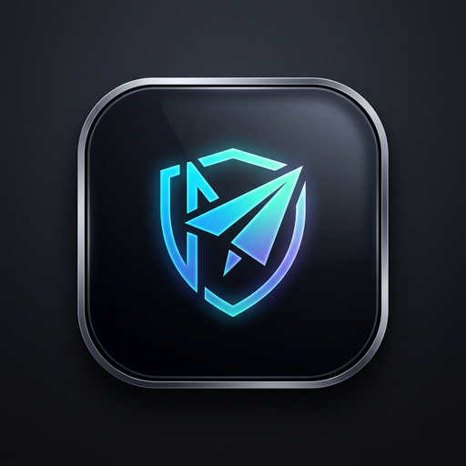

# 🚀 NickoGram — The Ultimate Stealth & Privacy Telegram Client

  

  <b>High-Performance • Stealth Protocol • DM Protection • Group Intelligence</b>

---

## 🌟 Key Features

### 🛡️ 1. DM Protection & Security Firewall
Full user control under **`Settings > DM Protection`** with individual toggles (All English UI):
* **Strict DM Lockdown:** Reject incoming messages from non-contacts. Senders immediately see a red **Failed to send (❗️)** error.
* **Instant Spam Strike & Auto-Report:** Automatically submits official spam reports with evidence to Telegram and blocks spammers, triggering immediate account limitation (`@SpamBot` flag).
* **Quarantine Unknown Senders:** Silently routes unknown messages to a separate 'Requests' folder without ringing or notifications.
* **Anti-Flood & Raid Protection:** Auto-silences spammers sending more than 5 messages within 3 seconds.
* **Peer-to-Peer (P2P) Call Shield:** Disables direct WebRTC P2P to prevent real IP address leaks during voice/video calls.
* **Phishing Link Scanner:** Highlights deceptive domains and phishing links in red warning banners.
* **Block Untrusted APK Downloads:** Prevents automatic downloading of `.apk` or `.exe` files sent by unknown accounts.
* **Restrict Forwarding Outgoing Messages:** Disallows recipients from copying or forwarding your messages.
* **Block Screenshots in Private Chats:** Prohibits screenshots and screen recording inside direct conversations.
* **Hidden Chat Vault & Panic Shake:** Lock private chats with a secret PIN; shake phone to instantly hide them.

---

### 👻 2. Phantom Voice Chat (The Desync Exploit)
* **100% Invisible Presence:** Listen and speak in group voice chats while completely omitted from the participant roster and count.
* **Signaling vs Media Desync:** Detaches from the MTProto participant roster while maintaining the WebRTC audio stream.
* **Masked Channel Identity:** Automatically joins using a masked channel profile.

---

### 🔍 3. Native Member Intelligence
* **Group Profile Action: `[🔍 Scan & Export Members]`:** Deep-scans 2,000 chat messages to harvest active members even when admins hide group members.
* **Cross-Group Member Filter:** Compare 2 groups directly inside the app to identify common members with one-tap administrative actions.

---

### 🕵️ 4. Stealth & Ghost Mode
* **Ghost Read Receipts:** Read messages without sending blue double-ticks (sender only sees a single tick).
* **Typing Stealth:** Suppresses typing and audio recording indicators.
* **Send without Online:** Send messages without broadcasting an active "Online" status.
* **Anonymous Story Viewer:** View stories anonymously without appearing in viewer lists.

---

### 🔓 5. Content Ripper & Anti-Restriction
* **Save Protected Content:** 1-tap download from channels with `chat.noforwards` and copy restrictions enabled.
* **Timer Destroyer:** Keeps 1-time view / self-destructing media permanently in gallery.
* **Bypass `FLAG_SECURE`:** Take screenshots everywhere, including secret chats.

---

### 🗑️ 6. Anti-Delete & Edit Vault
* **Deleted Messages Ledger:** Retains deleted messages inline with a red `[🗑️ Deleted]` timestamp badge.
* **Edit History Tracker:** View original message revisions before they were modified.

---

## 📲 How to Download the APK

1. Go to the **Actions** tab in this GitHub repository: `https://github.com/rishabh16120022/neckogram/actions`
2. Select the latest **"Build NickoGram APK"** workflow run.
3. Under the **Artifacts** section at the bottom of the page, click **`NickoGram-v1.0-debug-APK`** to download.
4. Install the `.apk` on your Android phone and log in with your Telegram account!

---

## 🛠️ Automated Cloud Build Pipeline
NickoGram uses GitHub Actions to compile native C++ and Kotlin/Java code in the cloud:
* **Workflow:** `.github/workflows/build_nickogram.yml`
* **Trigger:** Runs automatically on push to `main` or via manual trigger (**Run workflow** button).
